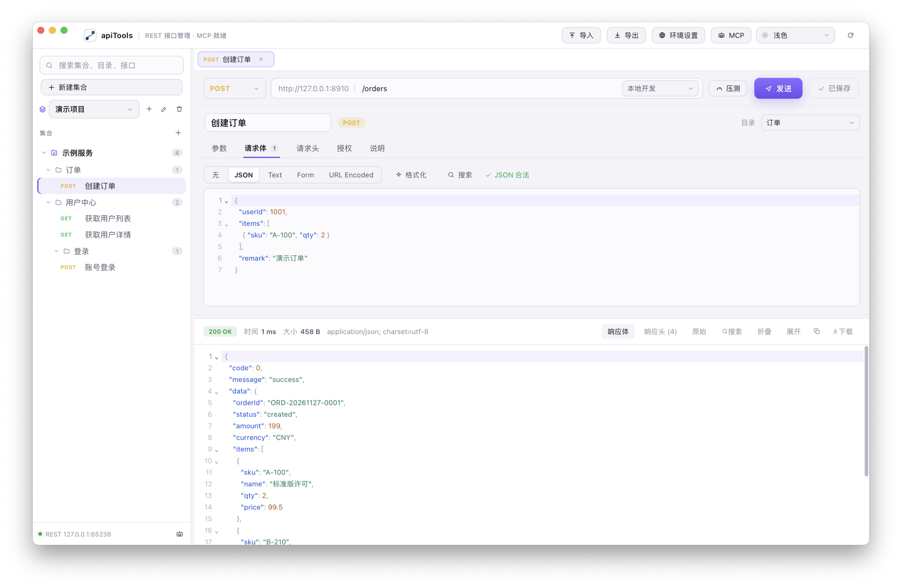

<div align="center">

# apiTools

**本地优先的 API 调试台 —— 接口、环境、压测、AI Agent，一个窗口搞定**

[](LICENSE)
[](https://github.com/Lixin-2/apiTools/releases)
[](#安装)
[](https://tauri.app)

 

<sub>浅色 / 深色双主题 · 环境下拉与 URL 前缀 · JSON 折叠与高亮</sub>

</div>

> 个人自用项目：按自己的工作流打磨，功能按需迭代，不追求大而全。

## 功能

| | |
| --- | --- |
| **请求调试** | 7 种方法；JSON / Text / Form（含文件上传）/ URL Encoded；Bearer / Basic / API Key；编辑器支持折叠与 `⌘F` 搜索，上万行 JSON 不卡 |
| **组织方式** | 多项目隔离；集合 → 多级目录 → 接口；标签页保留未保存改动，`⌘S` 保存、`⌘W` 关闭 |
| **环境** | 「统一 URL 前缀 + 统一请求头」配一次就够，接口里只写 `/users`；接口内同名 Header 优先 |
| **压测** | 并发 / 定时长 / 定请求数 / 逐级加压；不限速 / 固定 TPS / 随机 TPS；zip 报文池 + CSV 变量池；实时图表；后台运行 |
| **导入导出** | OpenAPI 3 / Swagger 2 / Postman / HAR / cURL 互转；响应二进制自动识别文件名与 MIME |
| **外观** | 浅色 / 深色 / 跟随系统；布局可拖动；全区域右键菜单 |

## 安装

| 平台 | 文件 |
| --- | --- |
| macOS（Apple Silicon） | `apiTools_x.y.z_aarch64.dmg` |
| Windows（x64） | `apiTools_x.y.z_x64-setup.exe`（推荐）或 `.msi` |

从 [Releases](https://github.com/Lixin-2/apiTools/releases) 下载。

> 未做代码签名：macOS 首次打开需右键 → 打开；Windows 点「更多信息 → 仍要运行」。
> 升级直接覆盖安装，数据保留（Windows 请固定用同一种安装包）。

## 快速上手

1. 新建集合 → 新建请求，填入 URL（或配合环境只写 `/users`）
2. 右上角「环境设置」配一次 URL 前缀与公共请求头
3. 顶部「MCP」开启服务，把配置粘到 Claude / CodeBuddy / Cursor，Agent 就能直接管接口

## MCP 接入

右上角 **MCP** 面板可开关、改端口（默认 `4732`），配置一键复制。

```json
{
  "mcpServers": {
    "apitools": { "url": "http://127.0.0.1:4732/mcp" }
  }
}
```

Agent 可以读取项目 / 集合 / 目录结构，创建目录、写入接口、发请求验证，改动实时出现在界面里。

## 许可证

[Apache License 2.0](LICENSE) · Copyright 2026 apiTools contributors
