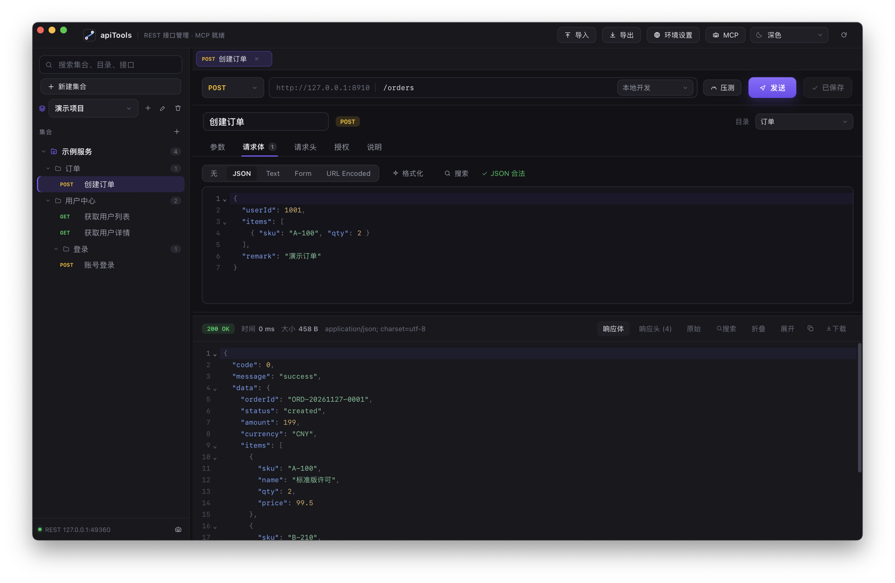

# apiTools

**本地优先的 API 调试台 —— 接口、环境、压测、AI Agent，一个窗口搞定**

 

> 个人自用项目：按自己的工作流打磨，功能按需迭代，不追求大而全。

## 安装

| 平台 | 文件 |
| --- | --- |
| macOS（Apple Silicon） | `apiTools_x.y.z_aarch64.dmg` |
| Windows（x64） | `apiTools_x.y.z_x64-setup.exe`（推荐）或 `.msi` |

从 [Releases](https://github.com/Lixin-2/apiTools/releases) 下载。

> 未做代码签名：macOS 首次打开需右键 → 打开；Windows 点「更多信息 → 仍要运行」。
> 升级直接覆盖安装，数据保留（Windows 请固定用同一种安装包）。

## 许可证

[Apache License 2.0](LICENSE) · Copyright 2026 apiTools contributors
